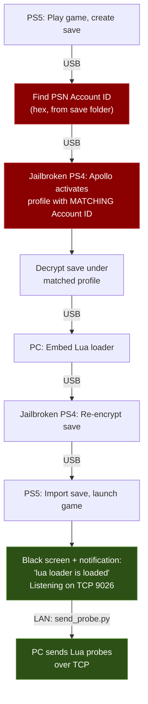

# PS5 Firmware 14.10 - Kernel Research

Open community kernel exploit research on PlayStation 5 firmware **14.10**. This project attacks the PS5 security stack from two directions: a **Lua 5.1 loader** (TCP 9026, via game save exploit) for direct kernel/syscall research, and a **WebKit/JSC crash corpus** targeting the console's browser engine. 2682 probes written, 3005 result captures, 170+ technical documents, 80+ merged PRs, 80+ documented dead ends, 52 research phases.

> **Goal:** Userland code execution -> kernel R/W -> hypervisor bypass. Kernel read/write on 14.10 is **not demonstrated**. The Lua loader gives us powerful userland primitives (threading, heap R/W, arbitrary function calls, syscall invocation). The Lua loader kernel attack surface is exhausted. WebKit Canvas UAF (CVE-2026-43720) is the only live vector — it needs a browser access mechanism and an alternative info leak.

---

## License

This work is licensed under [CC BY-NC 4.0](LICENSE). You are free to share and adapt it, but you **must give credit** (link to this repository and name the author) and you **may not use it commercially**. If you post findings from this research, credit [@ZiggyVall](https://x.com/ZiggyVall) and link back to this repo.

---

## Funding

<a href="https://www.paypal.me/SalwanStudios">

</a>

> **When donating via PayPal, please send as Friends & Family** (not Goods & Services) to avoid payment holds and fees.

### Thank You to Our Donors

These people believed in this research and put their money where their mouth is. It means the world <3

```
Ivan Milinski  ·  Felix Dietz  ·  Brian Alejandro Camacho  ·  Jonathan Moreau  ·  Frank Munsche  ·  Mohammed Kazi  ·  Ismael Jesus  ·  Cassidy Poynter  ·  Mohammad Islam  ·  Flix Rely  ·  Paul E Fox  ·  K Lam  ·  Sean Verkempinck  ·  Jacob Maurer
```

---

## Attack Surface Overview

The PS5 security stack has multiple layers. This project researches all of them:


### Entry Vector 1: Lua 5.1 Loader (Primary)

The game **Hamidashi Creative** (Artemis/Lua engine) loads a modified save file that starts a TCP listener on port 9026. We send Lua probe scripts over the network. This gives us:

- Direct memory read/write via `memory.*` API
- Syscall invocation via `make_syscall(N)` (bypasses Lua-side filter; kernel restrictions still apply)
- GPU mmap for large heap R/W (256+ pages, no guard pages)
- CClosure function pointer redirect for calling existing Lua C functions
- `native.fcall_with_rax` for arbitrary userland function calls
- Thread creation via `thr_create(430)` with full register control and `thr_new(455)` with arg delivery
- Child thread ROP syscalls (5-arg) via native gadget chains
- Per-connection ASLR (fresh process per TCP connection)

### Entry Vector 2: WebKit / JSC (Browser Engine)

The PS5's built-in browser runs a WebKit engine forked before Safari 17.0 (Sep 2023 branch, JIT disabled, LLInt only). This project maintains:

- **518-case JSC crash corpus** targeting WebKit bugs fixed after the Safari 17.0 branch (harvested by `tools/webkit_crash_corpus.py`)
- **17 browser probes** (phase13_webkit): MetadataTable overflow, engine fingerprint, capability map, crash oracle, corpus runner
- **Poly-proto OOM reproducer** (12 lines, exhausts WebProcess memory in ~1 second, PR #77)
- **p172 iframe runner** for executing crash cases on-console
- **WebKit canary battery** (11 probes testing Relapse scope-leak, popup isolation, etc.)
- Cross-reference with [pastawithpesto/PS5-14.10-Jailbreak-Research](https://github.com/pastawithpesto/PS5-14.10-Jailbreak-Research) for MetadataTable overflow (CVE-2026-64784) and CSSFontFace UAF (CVE-2026-43715)

Key WebKit findings: No WebAssembly, no SharedArrayBuffer, no WebGL. All 3 Relapse WebKit bugs patched. Popup isolation is dead (all methods kill WebProcess). **Canvas UAF (CVE-2026-43720) confirmed on 14.10** — write primitive claimed (p553), but `IPV6_2292PKTOPTIONS` (info leak vehicle) is blocked. Canvas UAF probes p553-p563 target size-class scanning and alternative reclaim paths. Corpus has not been fully run on-console yet.

See [docs/WEBKIT_FINDINGS.md](docs/WEBKIT_FINDINGS.md), [docs/WEBKIT_CORPUS.md](docs/WEBKIT_CORPUS.md), [docs/WEBKIT_LENGTH_WINDOW_AUDIT.md](docs/WEBKIT_LENGTH_WINDOW_AUDIT.md), [docs/PROLAPSE_CANVAS_UAF.md](docs/PROLAPSE_CANVAS_UAF.md).

---

<!-- RESEARCH_PROGRESS:START -->
## Research progress

[](docs/PROGRESS_AUDIT.md)

**63/100 (~63%) on a subjective, evidence-weighted milestone rubric.** (Score pending re-evaluation — AIO 662 vector closed Oct 27, 2026.) This is not a measured percentage of unknown exploit work, time remaining, or probability of success. **Kernel read/write on 14.10 is not demonstrated.** Hypervisor bypass is excluded from this score.

| Milestone | Points earned / weight |
|---|---:|
| 14.10 research environment | 10/10 |
| Probe tooling and captured evidence | 10/10 |
| Target characterization | 15/15 |
| Kernel attack surface mapping | 10/10 |
| WebKit / JSC attack vector | 8/10 |
| Exploit infrastructure | 5/5 |
| Validated 14.10 kernel vulnerability | 5/10 |
| Demonstrated 14.10 kernel read/write | 0/15 |
| Repeatable complete kernel exploit | 0/15 |

Audited 2026-10-25. [Evidence and counting rules](docs/PROGRESS_AUDIT.md) · [Machine-readable rubric](docs/progress.json) · [Website](https://marwanmohamed.ca/researchps5#research-progress)

**Correction:** Probe 45c retracts earlier `fn_addr`/ROP execution and W^X-bypass claims. Those are not credited by this meter; historical diagrams and older findings are not current proof. 13.60 artifacts do not establish 14.10 exploitability.
<!-- RESEARCH_PROGRESS:END -->

---

## Confirmed Working Primitives

These are the tools we can use right now on 14.10:

| Primitive | How | Probe |
|-----------|-----|-------|
| **Thread ROP execution** | `thr_create(430)` with CS=0x43/SS=0x3B, full GP register control. Multi-gadget chains (pop rdi, pop rax, mov [rdi],eax;ret) confirmed. Thread wrote 0xDEADBEEF to controlled address. | 80a-80k, 156c/156d |
| **Arbitrary userland function calls** | `native.fcall_with_rax`: getpid=0x22a, socket=0x16, close=0x0 all correct | 129b |
| **C11 threading** | `Thrd_create` spawns 5+ concurrent threads with join. `Atomic_fetch_add_8` as entry verified. Budget: 8 children max. | 126g/126h, PR #71 |
| **Heap R/W (256+ pages)** | GPU mmap adjacency, no guard pages | 41c |
| **CClosure function redirect** | Selected existing Lua C targets (rawequal/rawget/type) produced target-like outputs with restore checks. Arbitrary target/ABI and ROP support remain unverified. | 56c/56f |
| **Raw syscall invocation** | `make_syscall(N)` for tested numbers. Bypasses Lua-side filter only; kernel restrictions apply. | multiple |
| **Userland ASLR bypass** | `dynlib_get_info(593)` returns base addresses for 39 userland modules. Kernel ASLR is separate. | 41o |
| **Full process VM map** | sys 674 returns 317 named regions with protections. All userland VA. | 55e/55f |
| **Network packet injection** | RAW socket + IP_HDRINCL, TCP connect-back with ARP responder | 34-39 |
| **sys 624 VM operation counter** | +5 per mmap, zero jitter, monotonic. Side channel for counting kernel VM ops. | 52b |
| **Device inventory** | 34 of 76 `/dev` nodes open from game process. ioctl(54) reaches all 34 drivers. | 259a-268a |
| **UMTX functional** | UMTX_OP_WAIT blocks on value match, NWAKE_PRIVATE returns 0, MUTEX_LOCK writes owner TID | 56i2, 152k |
| **POSIX shm (shm_open/ftruncate/mmap)** | shm_open(482) works: SHM_ANON, named objects, O_CREAT\|O_RDWR, ftruncate, mmap(MAP_SHARED). shm_open2(571) is nosys. | 391a-391d |
| **AllocateDirectMemory (GOT wrapper)** | `libkernel+0x17EF0` works from sandbox via GOT — rv=0, phys `0x110010000`+. GetDirectMemorySize returns `0x150000000` (5GB GPU pool). | DEM9N101 |
| **dmem0 mmap R/W (main thread)** | `open("/dev/dmem0")` + `mmap(477)` with MAP_SHARED\|MAP_FIXED maps allocated physical pages at controlled VA. Full R/W confirmed. Bypasses sceKernelMapDirectMemory crash. GPU pool only (0x100000000-0x150000000). | 545h |

---

## Hard Walls (What's Blocking Us)

| Wall | Detail |
|------|--------|
| **No kernel pointers found** | 17+ KASLR techniques tested across every accessible interface. Zero kernel pointers. |
| **W^X enforced** | `mmap(RWX)` gives RW only. `mprotect(EXEC)` always fails. No bypass found. |
| **Execute-only memory (XOM)** | System lib .text is XO (reading crashes past pcall). Eboot .text is RX (readable). |
| **kldstat/kldnext lethal** | sys 307/308/337 instantly kill the process. Host-only syscalls in console kernel. |
| **AF_ROUTE sanitized** | Kernel zeroes all pointers in route messages. Relapse KASLR technique is dead on 14.10. |
| **RDMSR blocked** | sys 626 and sys 567 return -1 for all MSR indices. |
| **SMAP enforced** | No timing differentiation between mapped/unmapped kernel VA. |
| **fork/rfork blocked** | `thr_create(430)` and `thr_new(455)` both work. `fork`, `rfork` stay blocked. |
| **Sysent ends at 676** | 677+ all kill the process (thirty-one consecutive, reads as past-the-end). |
| **Device ioctls reject everything** | Sony uses NID-hash command codes, not FreeBSD `_IOC` encoding. 13.60 NIDs don't work on 14.10. |
| **Physical memory limited to GPU pool** | dmem0 mmap only reaches phys 0x100000000-0x150000000 (GPU direct memory). Kernel lives in system RAM (phys < 0x100000000), unreachable via any device fd we can open. Dense 16GB scan (547a-547g): 100% rejection above 5.25GB. dmem1/dmem2 expose the same pool. gc/dce/zero reject all offsets. AllocateDirectMemory only allocates within GPU pool. |
| **Sony syscalls exhausted** | All accessible Sony syscalls tested for kernel pointer leaks (548a). 596=no-op, 604=always -1, 559=boolean, 615/613=gated. Zero kernel pointers from any accessible Sony syscall. |
| **UMTX_OP_SHM stubbed** | All sub-ops return 0 but do nothing. CVE-2024-43102 is not exploitable on 14.10. |
| **netcontrol UAF dead** | Reference leak, not free. Public ExploitNetControlImpl precondition does not hold. |

### Tested KASLR Candidates (All Failed)

| Technique | Result | Probe |
|-----------|--------|-------|
| AF_ROUTE kernel pointer leak (Relapse) | Sanitized | 53b |
| mincore/msync/madvise oracle | Lethal | 56k |
| Timing side-channel via CClosure redirect | SMAP blocks | 56j |
| Signal handler fault recovery oracle | Handler bypasses pcall | 56k2/56k3 |
| RDMSR (sys 626, 567) | Returns -1 | 54k |
| kldstat/kldnext (sys 307, 308) | Lethal | 56k4/56k5 |
| mod* syscalls (sys 300-302) | Returns -1 | 56k5 |
| kldsym (sys 337) | Lethal | 171a |
| sysctl kernel pointer scan | All sentinels | multiple |
| sys 674 VM map (317 regions) | All userland VA | 55e/55f |
| sys 649 module members | Userland addresses only | 54k |
| kinfo_proc full dump | Only sentinels | multiple |
| net.route.iflistl scan | sockaddr/MAC, no pointers | 54f |
| sys 593 deep struct scan | NID hashes, not pointers | 54f |
| sys 639/638 memory region | Returns -1 | 54f |
| kern.proc.filedesc/vmmap | Blocked (ret=-1) | multiple |
| sys 588 (13.60 exploit path) | No-op on 14.10 | 54d |
| dmem0 16GB physical memory scan | GPU pool only (0-5.25GB), 100% reject above | 547a-547g |
| dmem1/dmem2/gc/dce/zero phys access | Same pool or reject | 547f |
| Sony sys 596/604/559/615/613 | All dead (no-op, -1, boolean, gated) | 548a |
| /dev/gc ioctl surface (32M calls) | Zero kernel pointers, 25 inert commands | 259a-268a |

---

## Current Priority Vectors

These are the active leads, ranked by potential:

### 1. Canvas getContext() Reentrancy UAF (CVE-2026-43720) — Community WebKit Chain

[pastawithpesto/PS5-14.10-Jailbreak-Research](https://github.com/pastawithpesto/PS5-14.10-Jailbreak-Research) has a WebKit chain at stages 5/8 confirmed: UAF trigger, same-type reclaim, alias R/W through 12 Canvas2D APIs, crash oracle, and APNG-based ASLR defeat. **Remaining:** arbitrary R/W (lineDash vector forge) and code exec (vtable hijack + ROP). **Current blocker:** live vtable offset on 14.10 is unknown (13.00 offset ruled out, [issue #47](https://github.com/pastawithpesto/PS5-14.10-Jailbreak-Research/issues/47)). Key PS5 properties: IsoHeap OFF, Gigacage DISABLED, JSC Config unfrozen (instant type confusion with arb write), JIT disabled (LLInt only). Our Canvas UAF probe (p550) targets the same CVE from the Lua side.

### 2. WebKit FontFaceSet UAF (CVE-2026-43715)

FontFaceSet::load() UAF validated on 14.10 with 4/5 deterministic crash rate. Root cause: weak refs in FontFaceSet::load vs strong refs in iterateClients. Two independent researchers confirmed (PR #149, issue #143). Next: same-size class substitution with shapeable field + address disclosure. Our Lua primitives may contribute the addr-leak side.

### 3. JSC crash corpus (518 cases)

Post-Safari-17.0 regression tests targeting WebKit bugs the PS5 browser engine predates. Even one crash is a lead. Corpus generated by `webkit_crash_corpus.py` (PR #75). p172 iframe runner is built. Not yet fully run on-console.

### 4. fd-close/sendmsg race via child thread

Use thr_new ROP child to close(fd) simultaneously with main thread sendmsg(SCM_RIGHTS, fd). 20 iterations clean (534e), but larger runs may hit the race window. Low confidence but mechanically sound.

### 5. UMTX PI orphaned waiter escalation

Thread exit never disowns a PI mutex — leaves kernel wait queue entry intact (274e/274f). Real kernel state touched but no controlled corruption demonstrated. Needs deeper exploitation strategy.

---

## CVE Assessments

This project has assessed 12+ FreeBSD CVEs against the 14.10 attack surface:

| CVE | Title | Status | Document |
|-----|-------|--------|----------|
| CVE-2026-49418 | msync device-pager UAF | **Closed** - MS_INVALIDATE returns EINVAL on all game-process mappings | [Assessment](docs/CVE-2026-49418-PS5-14.10.md) |
| CVE-2024-43102 | UMTX SHM race | **Dead** - SHM stubbed | [Evidence](docs/UMTX_454_EVIDENCE.md) |
| CVE-2026-49412 | Kernel vulnerability | Assessed | [Assessment](docs/CVE-2026-49412-PS5-14.10.md) |
| CVE-2026-49419 | Kernel vulnerability | Assessed | [Assessment](docs/CVE-2026-49419-PS5-14.10.md) |
| CVE-2026-49422 | RACK TCP | Assessed | [Assessment](docs/CVE-2026-49422-PS5-14.10.md) |
| CVE-2026-49424 | Linuxulator | Assessed | [Assessment](docs/CVE-2026-49424-PS5-14.10.md) |
| CVE-2026-49427 | Kernel vulnerability | Assessed | [Assessment](docs/CVE-2026-49427-PS5-14.10.md) |
| CVE-2026-58083 | Kernel vulnerability | Assessed | [Assessment](docs/CVE-2026-58083-PS5-14.10.md) |
| CVE-2026-58090 | Kernel vulnerability | Assessed | [Assessment](docs/CVE-2026-58090-PS5-14.10.md) |
| CVE-2026-58093 | Kernel vulnerability | Assessed | [Assessment](docs/CVE-2026-58093-PS5-14.10.md) |
| CVE-2026-45258 | Kernel vulnerability | Assessed | [Assessment](docs/CVE-2026-45258-PS5-14.10.md) |
| CVE-2026-7270 | Kernel vulnerability | Assessed | [Assessment](docs/CVE-2026-7270-ASSESSMENT.md) |
| CVE-2019-5607 | SCM_RIGHTS | Binary verified | [Chain](docs/CVE-2019-5607-EXPLOIT-CHAIN.md) |

---

## Exploit Chain Overview

```mermaid
graph LR
    A["Hamidashi Creative<br/>(Artemis Engine)"] -->|modified save file| B["Lua 5.1 Loader<br/>TCP 9026"]
    B -->|memory.* / syscall.*| C["Confirmed userland primitives<br/>Thread ROP, CClosure redirect,<br/>Heap R/W, arbitrary calls"]
    C -->|"No validated kernel base"| D["KASLR defeat<br/>not demonstrated"]
    D -->|requires KASLR defeat| E["Kernel R/W<br/>not demonstrated"]
    E -->|requires kernel R/W| F["Hypervisor bypass<br/>not demonstrated"]

    style A fill:#2d5016,stroke:#4a8c2a,color:#fff
    style B fill:#2d5016,stroke:#4a8c2a,color:#fff
    style C fill:#2d5016,stroke:#4a8c2a,color:#fff
    style D fill:#8b0000,stroke:#cd5c5c,color:#fff
    style E fill:#8b0000,stroke:#cd5c5c,color:#fff
    style F fill:#8b0000,stroke:#cd5c5c,color:#fff
```



---

## Environment

| Property | Value |
|----------|-------|
| Firmware | 14.10 |
| Kernel | FreeBSD r230171 (Sep 28 2026) |
| Entry points | Lua 5.1 loader on TCP 9026 + WebKit browser engine |
| Page size | 16 KB (0x4000) |
| CPU | Zen 2, 8C/16T (16 logical cores) |
| Securelevel | 1024 (PS5-specific) |
| Measured sysent | 676 entries (677+ lethal) |
| Open /dev nodes | 34 of 76 (gc, dce, ajm, dmem0-2, rng, gic, camera, usb, hid, bt, notification*, HMD sets) |

---

## Repository Structure

```
probes/                              # 2682 Lua probe scripts across 52 phases
  phase1_identity_layout/            # 01-08: system ID, syscalls, memory layout
  phase2_kernel_objects/             # 09-21: UMTX, nwake, dmem, AIO, kqueue
  phase3_signals_codexec/            # 22-26: signals, sigaltstack, W^X, XOM
  phase4_ipc_network/               # 27-31: threading, fd passing, socket opts
  phase5_buffer_io/                  # 32-33: buffer stress, MSG_DONTWAIT
  phase6_raw_packets/               # 34-39: RAW sockets, fragments, IP options
  phase7_heap_exploitation/          # 40-41: GPU mmap, heap R/W, ROP, ASLR bypass
  phase8_live_network/              # 40tcp, 42: TCP fuzz, ktimer, live testing
  phase9_kaslr_defeat/              # 42b-42j: KASLR attempts, ROP architecture
  phase10_untested_theories/         # 43a+: theory-driven probes
  phase11_network_attacks/           # 48a-50d: SCTP, IPv6, TCP inject, exotic protocols
  phase12_kernel_analysis/           # 51a+: kernel dump sysent analysis
  phase12_kernel_dump/              # Kernel dump analysis tools
  phase13_52batch/                  # 52a-52b: Sony syscall survey 627-676 + 624 oracle
  phase13_53batch/                  # 53a-53d: evidence-audit retests
  phase13_webkit/                   # 17 browser probes: MetadataTable, engine fingerprint, corpus runner
  phase14_cclosure_redirect/         # CClosure +0x20 redirect experiments
  phase14_final_push/               # 54a-56l: deep syscall survey, CClosure, KASLR exhaustive
  phase15_native_sysent/            # 57a+: native sysent survey, msync CVE probe
  phase16_thr_create_crash/          # thr_create(430) crash analysis and CS=0x43 fix
  phase17_new_vectors/              # 339 probes: massive vector exploration
  phase17_seg_hypothesis/           # Segment register hypothesis testing
  phase17_threading/                # Threading primitive development
  phase18_race_conditions/          # Race condition setup
  phase18_race_ingredients/         # Race primitive building blocks
  phase19_umtx_454/                 # 22 probes: UMTX on syscall 454 (corrected from 557)
  phase22_threaded_races/           # 20 probes: PI-mutex races, gadget catalog, child syscalls
  phase23_ajm_a53/                  # AJM ioctl NID sweep (A53 coprocessor path)
  phase24_kernel_leak_hunt/         # Latest kernel pointer search attempts
  phase27_phys_memory/               # Physical memory mapping (dmem0, device pager, GPU pool)
  phase29_aio_race/                  # AIO TOCTOU race escalation (DoS only)
  phase30_mapdirect_loader/          # MapDirectMemory main-thread (544a-545h: mmap+dmem0 breakthrough)
  phase31_sony_leak/                 # Sony syscall kernel pointer leak hunt
  phase32_aio_race/                  # AIO race escalation (closed: double-STATUS not double-free)
  phase33_umtx_exploit/              # UMTX exploit research
  ...                                # 52 phases total — see probes/ directory

results/                             # 3005 raw output captures (same phase structure)

tools/                               # 65+ scripts and utilities
  send_probe.py                      # Primary probe sender (Python, TCP with 8B LE prefix)
  send_probe.ps1                     # PowerShell probe sender (no Python required)
  run_probe_batch.py                 # Bounded sequential probe execution
  kaslr_bruteforce.py               # Multi-connection KASLR brute-force driver
  syscall_isolation_sweep.py         # One-connection-per-syscall measurement
  webkit_crash_corpus.py            # JSC regression test harvester (518 cases)
  verify_offline.py                  # CI: hardware-free evidence verification
  analyze_result.py                  # Result file parser and kernel pointer scanner
  deep_result_scanner.py            # Cross-result pattern finder
  bounds_fuzz.py                    # Sony handler buffer size fuzzer
  restart_pressure.py               # Resource accumulation measurement across kills
  console_control/                  # Unattended PS5 control via Remote Play
  browser_battery/                  # WebKit canary test battery
  browser_runner/                   # On-device crash case runner
  ghidra/                           # Ghidra analysis scripts for 13.60 kernel
  v1360-dumper/                     # 13.60 kernel dump tools (C payload + receiver)

docs/                                # 170+ technical documents
  ATTACK_SURFACE.md                  # Complete syscall status map (676 entries)
  FINDINGS.md                        # Detailed technical findings
  PROBE_INDEX.md                     # Every probe with status and key result
  STRATEGY.md                        # Exploit strategy and dead ends
  UNTESTED_THEORIES.md              # Ranked exploit theories
  RESEARCH_PAPER.md                 # Full technical research paper
  RESEARCH_EVIDENCE.md              # Evidence ledger guide
  THREADING_ALIVE_14_10.md          # thr_create(430) full decode
  SYSENT_PRESENCE_14_10.md          # Measured sysent boundaries (676 entries)
  WEBKIT_FINDINGS.md                # WebKit engine findings and capability map
  WEBKIT_CORPUS.md                  # JSC crash corpus documentation
  AJM_IOCTL_REVERSAL_13_60.md      # Sony NID-hash ioctl command discovery
  NETCONTROL_14_10.md               # netcontrol UAF analysis (dead on 14.10)
  UMTX_454_EVIDENCE.md             # UMTX syscall correction (557 was wrong)
  CVE-*.md                          # 12+ CVE assessments
  ALL_RESULTS.md                    # Every result concatenated (for large-context AI)
  ALL_PROBES.md                     # Every probe concatenated (for large-context AI)
  USERLAND_ENTRY.md                 # Full setup guide and game details
```

---

## Quick Start

```bash
# Send a probe (Python)
PYTHONIOENCODING=utf-8 python tools/send_probe.py --save probes/phase14_final_push/56c_redirect_nonvm.lua

# Send a probe (PowerShell, no Python required)
.\tools\send_probe.ps1 probes\phase14_final_push\56c_redirect_nonvm.lua -Save

# Run multiple probes sequentially
python tools/run_probe_batch.py probes/phase22_threaded_races/271*.lua

# KASLR brute force driver (multi-connection)
python tools/kaslr_bruteforce.py --ps5-ip YOUR_PS5_IP --step 0x200000

# Syscall isolation sweep (one connection per number)
python tools/syscall_isolation_sweep.py --range 661-670

# Harvest WebKit crash corpus from public regression tests
python tools/webkit_crash_corpus.py --output probes/phase13_webkit/

# Hardware-free CI verification (no console needed)
python3 tools/verify_offline.py
```

See [tools/README.md](tools/README.md) for full tool documentation.

---

## Userland Entry

The exploit chain uses **Hamidashi Creative** (a Japanese visual novel on the Artemis/Lua engine) as the entry point. A modified save file embeds the Lua loader, which starts a TCP listener on port 9026.



> Red = critical step (Account ID must match or PS5 rejects the save)

- **Game:** Hamidashi Creative - free demo on Japanese PSN
- **Loader:** Based on [shahrilnet/remote_lua_loader](https://github.com/shahrilnet/remote_lua_loader)
- **Kernel offsets:** From [@hammer-83](https://github.com/hammer-83)'s [ps5-jar-loader](https://github.com/hammer-83/ps5-jar-loader) (fw 1.00-10.01 only; 14.10 offsets TBD)
- **Entry method:** Save file exploit via PS4 backwards compatibility

See [docs/USERLAND_ENTRY.md](docs/USERLAND_ENTRY.md) for the full setup guide.

---

## Use AI to Help

All research data is in this repo so anyone can feed it to their AI model of choice.

**For maximum-context models (1M+ tokens):**
- Feed `docs/ALL_RESULTS.md` + `docs/ALL_PROBES.md` + `CLAUDE.md` for the entire research corpus
- Ask the model to find novel KASLR defeat paths that haven't been tried
- Ask it to cross-reference 13.60 kernel dumps against 14.10 behavior

**For smaller context models:**
1. Start with `README.md` and `CLAUDE.md` for the full picture
2. Feed `docs/STRATEGY.md` for what's been tried and what's next
3. Feed `docs/FINDINGS.md` for all technical findings
4. Point it at specific probe results in `results/` for raw data analysis

**What we need help with most:**
- **KASLR defeat** - 17 techniques tested, all dead. Need a novel information leak path.
- **13.60 to 14.10 kernel diff analysis** - the companion repo has 13.60 kernel dumps. What changed?
- **FreeBSD r230171 source analysis** - find exploitable code paths reachable from our ~40 working syscalls
- **WebKit/JSC crash analysis** - run the 518-case corpus, analyze any crashes
- **Device driver reverse engineering** - Sony NID command codes for the 34 open /dev nodes

---

## Related Research

### V13.60 Kernel Research
The companion [PS5 V13.60 Research](https://github.com/ZigZagBoi1/PS5-V13.60-Research) repository maintains the firmware 13.60 Relapse and Byepervisor-Reborn research. Relapse's 13.60 support does not imply support on 14.10 (AF_ROUTE KASLR is confirmed dead here).

### WebKit Research (pastawithpesto)
[pastawithpesto/PS5-14.10-Jailbreak-Research](https://github.com/pastawithpesto/PS5-14.10-Jailbreak-Research) covers the browser side of the same 14.10 chain:
- Their Stages 1-2: WebKit corruption -> arbitrary R/W
- This repo: userland/kernel side (Lua loader, syscall surface, kernel exploitation)
- MetadataTable overflow (CVE-2026-64784) confirmed on two 14.10 consoles
- CSSFontFace UAF (CVE-2026-43715) device test deployed
- Their Stage 3/4 kernel candidates validated against our [ATTACK_SURFACE.md](docs/ATTACK_SURFACE.md)

---

## Key Constraints

- **W^X enforced** - `mmap(RWX)` gives RW only; `mprotect(EXEC)` always fails
- **Execute-only memory (XOM)** - system lib .text is XO (reading crashes); eboot is RX
- **Limited threading** - `fork`, `rfork` blocked; `thr_create(430)` and `thr_new(455)` both work
- **Per-connection ASLR** - fresh process per TCP connection, all addresses must be re-derived
- **SMAP enforced** - no timing differentiation between mapped/unmapped kernel VA
- **No kernel pointers found** - extensive scanning across every accessible interface
- **/dev/dmem0** - GPU aperture only, cannot access CPU/kernel physical memory
- **Port binding restricted** - bind() returns -1 for ports >= 40000, use 1024-32767

---

## Contributors

- **[ng643](https://github.com/ng643)** (Rithik Janarthanan) - PRs #6-8, #11-18, #21-27, #37, #39, #40, #44, #55-57, #69-77: Evidence corrections, sysctl MIB fixes, Tier 1/2/3 handler claim audits, CVE assessments, thr_create(430) full decode, kevent timeout matrix, syscall label table (153 entries), WebKit OOB audit, 14.10 WebKit fingerprint, crash corpus harvester, device inventory (34/76 nodes), UMTX high ops, netcontrol UAF closure, Sony object family sweep, thread budget measurement, JSC corpus, msync syscall correction, sysent tail resolution
- **[AJV20](https://github.com/AJV20)** - PRs #47-54: PowerShell capture path fixes, CI bounded hardware-free verification, ledger JSON validation, p161 chunk regression coverage, ledger-to-artifact binding, AIO/kevent evidence reconciliation, colliding capture preservation, failed evidence pair cleanup
- **[4TheDoctor](https://github.com/4TheDoctor)** (The Doc) - PRs #19-20, #28: CVE-2026-49418 msync device-pager UAF assessment (top exploit candidate), CVE assessments (58093/49427/49428/49424/49422), thr_* family survey (13 undocumented syscalls), probes 58a/58d/59a/59b
- **[pastawithpesto](https://github.com/pastawithpesto)** - PRs #4-5: Complete kernel handler reverse engineering (145/145 syscalls fw 13.60), WebKit entry vector analysis
- **[cobrajet302gt](https://github.com/cobrajet302gt)** - PRs #30, #32-33, #36, #46: CS=0/iretq thr_create(430) panic hypothesis + probes, live 14.10 WebKit stage-1 test, WebKit canary battery (11 probes), browser entry infrastructure, unattended console control via Remote Play
- **[Unkown607](https://github.com/Unkown607)** - PRs #9, #31, #34-35: 13.60 syscall name maps, compat-table capture identification, static thr_create(430) panic root-cause analysis (13.60 decompile), exploit surface analysis (CVE-2019-5607 + 3 CVEs + 5 race windows)
- **[Portablelle](https://github.com/Portablelle)** - PRs #41-43, #45: umtx 454 evidence correction (phase 1-2 probes called syscall 557 not 454), corrected probes, UMTX_OP_SHM/ROBUST_LISTS reachability probe, WebKit cross-link refresh, p161 blob fix
- **[kaydzer0305-png](https://github.com/kaydzer0305-png)** - PR #10: Offline evidence auditing framework
- **[wsjardijn](https://github.com/wsjardijn)** - Early research contributions

---

## Documentation Index

| Document | Contents |
|----------|----------|
| [CLAUDE.md](CLAUDE.md) | AI guide: probe template, helpers, dead ends, current priorities |
| [CHANGELOG.md](CHANGELOG.md) | Phase-by-phase progress timeline |
| [CONTRIBUTING.md](CONTRIBUTING.md) | How to contribute to this project |
| [docs/ATTACK_SURFACE.md](docs/ATTACK_SURFACE.md) | Complete syscall status map (676 entries) |
| [docs/FINDINGS.md](docs/FINDINGS.md) | Detailed technical findings |
| [docs/PROBE_INDEX.md](docs/PROBE_INDEX.md) | Every probe with status and key result |
| [docs/STRATEGY.md](docs/STRATEGY.md) | Exploit strategy, tiers, and dead ends |
| [docs/UNTESTED_THEORIES.md](docs/UNTESTED_THEORIES.md) | Ranked exploit theories |
| [docs/RESEARCH_PAPER.md](docs/RESEARCH_PAPER.md) | Full technical research paper |
| [docs/RESEARCH_EVIDENCE.md](docs/RESEARCH_EVIDENCE.md) | Evidence ledger guide |
| [docs/THREADING_ALIVE_14_10.md](docs/THREADING_ALIVE_14_10.md) | thr_create(430) full decode and mcontext layout |
| [docs/WEBKIT_FINDINGS.md](docs/WEBKIT_FINDINGS.md) | WebKit engine findings and capability map |
| [docs/WEBKIT_CORPUS.md](docs/WEBKIT_CORPUS.md) | JSC crash corpus documentation |
| [docs/USERLAND_ENTRY.md](docs/USERLAND_ENTRY.md) | Userland exploit setup guide |
| [docs/ALL_RESULTS.md](docs/ALL_RESULTS.md) | Every result in one file (for AI ingestion) |
| [docs/ALL_PROBES.md](docs/ALL_PROBES.md) | Every probe in one file (for AI ingestion) |

---

## Why This Is Open Source

By publishing every probe, every finding, and every commit publicly, this project is permanently disqualified from Sony's PlayStation Bug Bounty Program. That's a deliberate choice.

This research is for the community. When a kernel primitive is found, it won't be sold, it won't be held back, and it won't be gatekept. It'll be published here, for free, for anyone to use.

Everything here has been funded out of pocket. Donations help offset that cost, but they're never mandatory. This is a research project, not a product. It takes as long as it takes.

**Contributors welcome.** Whether you have the hardware or just want to analyze FreeBSD kernel code, there's work to do. See [CONTRIBUTING.md](CONTRIBUTING.md).

---

## Credits

- Userland loader: [@shahrilnet](https://github.com/shahrilnet) via [remote_lua_loader](https://github.com/shahrilnet/remote_lua_loader)
- Kernel offsets (fw 1.00-10.01): [@hammer-83](https://github.com/hammer-83) via [ps5-jar-loader](https://github.com/hammer-83/ps5-jar-loader)
- PS4 jailbreak: [GoldHEN](https://github.com/GoldHEN/GoldHEN) by [@SiSTRo](https://github.com/SiSTRo) and the GoldHEN team
- Save file management: [Apollo Save Tool](https://github.com/bucanero/apollo-ps4) by [@bucanero](https://github.com/bucanero)
- Relapse exploit research (fw 7.00-13.60): AF_ROUTE KASLR defeat technique and AIO race condition methodology
- Artemis engine Lua research: the PS5 homebrew scene

## License

This research is for educational and authorized security research purposes only.
