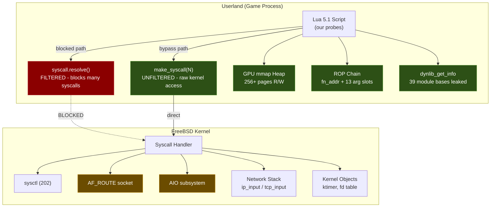
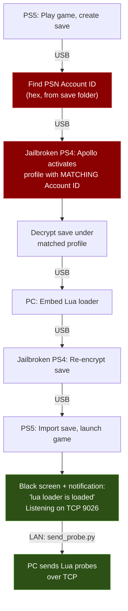

# PS5 Firmware 14.10 - Kernel Research

Open community kernel exploit research on PlayStation 5 firmware **14.10**, conducted via a userland Lua 5.1 loader on TCP 9026.

> **Goal:** Userland code exec → Kernel R/W → Hypervisor bypass

**Contributors welcome.** Whether you have the hardware or just want to analyze FreeBSD kernel code - there’s work to do. See [CONTRIBUTING.md](CONTRIBUTING.md) to get involved.

## Support This Research

Donations help cover tooling costs (AI-assisted analysis, hardware, infrastructure) and keep this research moving faster. No pressure — this project stays open and free regardless.

[](https://www.paypal.me/SalwanStudios)

## Exploit Chain Overview


> Green = confirmed working. Yellow = partially open. Red = not yet achieved.

## Status

All userland exploit primitives are confirmed working. The loader's ROP chain is fully decoded - a 0x300-byte structure with function target, 6 argument slots, and stack pivot, all writable from the heap. The sandbox filter in `syscall.resolve()` is bypassed via `make_syscall()`, opening access to every kernel syscall. **16 targeted probes (43a–43p) are ready to send** for the next testing session.

**Current milestone:** Defeat KASLR and achieve kernel memory read/write.

See [CHANGELOG.md](CHANGELOG.md) for a detailed timeline.

## Related V13.60 Research

The companion [PS5 V13.60 Research](https://github.com/ZigZagBoi1/PS5-V13.60-Research) repository maintains the firmware 13.60 Relapse and Byepervisor-Reborn research, its local browser site, and observed stage evidence. This V14.10 project retains `docs/ps5_13.60_sysent.json` for existing strategy and probe tooling; the source copy and attribution are maintained in the companion repository. Relapse's 13.60 support does not imply support on 14.10.

## Architecture



## Confirmed Primitives

| Primitive | How | Probe |
|-----------|-----|-------|
| Arbitrary syscall | `make_syscall(N)` bypasses `syscall.resolve()` sandbox | 41w |
| Heap R/W (256+ pages) | GPU mmap adjacency, no guard pages | 41c |
| ASLR bypass | `dynlib_get_info(593)` leaks all 39 module bases | 41o |
| Full ROP gadget set | Extracted from eboot (RX, not XO) | 41r–t |
| ROP chain hijack | `fn_addr` + all 13 arg slots writable from heap | 41z |
| Stack pivot | `pop rsp; ret` at eboot+0x9A2 | 42i |
| Kernel info via sysctl | FreeBSD r230171, securelevel=1024, 16KB pages | 42a |

## Key Constraints

- **W^X enforced** - `mmap(RWX)` gives RW only; `mprotect(EXEC)` always fails
- **Execute-only memory (XOM)** - system lib .text is XO (reading crashes); eboot is RX
- **No threading** - `fork`, `rfork`, `thr_new` blocked via resolve() (untested via `make_syscall`)
- **AIO sandbox-killed** - all `aio_*` syscalls terminate the process
- **Per-connection ASLR** - fresh process per TCP connection
- **No kernel pointers in userland heap** - exhaustive 10,240 qword scan found nothing
- **/dev/dmem0** - GPU aperture only, cannot access CPU/kernel physical memory

## Next Targets (Ready to Send)

**Tier S+ - Send FIRST (scene-proven technique):**
| Probe | Target | Why |
|-------|--------|-----|
| `43o_afroute_kaslr` | AF_ROUTE socket RTM_GET | Relapse exploit's KASLR defeat - worked on PS5 in the wild |
| `43p_aio_bypass` | AIO via `make_syscall` | If AIO lives past resolve(), race conditions reopen (Relapse bug class) |

**Tier S - Then these:**
| Probe | Target | Why |
|-------|--------|-----|
| `43a_kldstat_kaslr` | `kldstat` (syscalls 308 & 367) | Kernel base address in one call |
| `43b_kldsym_resolve` | `kldsym` (337) | Resolve any kernel symbol by name |
| `43d_kinfo_proc_full` | Full kinfo_proc dump | Every byte of 1096-byte struct for kernel pointers |
| `43i_fn_redirect` | ROP chain fn_addr | Confirm function redirect works across syscalls |

**Tier A - Then these:**
| Probe | Target | Why |
|-------|--------|-----|
| `43c_sysarch_gsbase` | `sysarch` GET_GSBASE (op 130) | May leak kernel `curthread` pointer |
| `43e_blocked_syscall_bypass` | `thr_new`, `ioctl`, `dup`, `fstat`, `pipe2` | Test "blocked" syscalls via `make_syscall` |
| `43f_sysctl_write` | Sysctl write paths | Lower securelevel, enable coredump |
| `43g_sony_syscall_sweep` | Syscalls 540–700 | Find unknown live Sony syscalls |
| `43h_mtypeprotect_wxbypass` | `sceKernelMtypeprotect` (585) | Potential W^X bypass |

**Tier B - Exploitation primitives:**
| Probe | Target | Why |
|-------|--------|-----|
| `43j_msgbuf_full_read` | Full kern.msgbuf (64KB) | Boot messages may contain KASLR-defeating addresses |
| `43k_cpuusage_deep` | `sceKernelGetCpuUsage` (617) + mtypeprotect (585) | Live Sony syscalls with proper buffers + W^X bypass test |
| `43l_mincore_kaslr` | `mincore()` kernel VA probing | Side-channel KASLR oracle via page residency |
| `43m_sockopt_overflow` | PS5 socket opts with oversized buffers | Kernel heap overflow if buffer isn't bounds-checked |
| `43n_hid_ioctl` | `/dev/hid` + `ioctl` via `make_syscall` | HID driver kernel state access |

## Repository Structure

```
probes/
  phase1_identity_layout/    # 01–08: system ID, syscalls, memory layout
  phase2_kernel_objects/     # 09–21: UMTX, nwake, dmem, AIO, kqueue
  phase3_signals_codexec/    # 22–26: signals, sigaltstack, W^X, XOM
  phase4_ipc_network/        # 27–31: threading, fd passing, socket opts
  phase5_buffer_io/          # 32–33: buffer stress, MSG_DONTWAIT
  phase6_raw_packets/        # 34–39: RAW sockets, fragments, IP options
  phase7_heap_exploitation/  # 40–41: GPU mmap, heap R/W, ROP, ASLR bypass
  phase8_live_network/       # 40tcp, 42: TCP fuzz, ktimer, live testing
  phase9_kaslr_defeat/       # 42b–42j: KASLR attempts, ROP architecture
  phase10_untested_theories/ # 43a–43p: theory-driven probes (READY TO SEND)
  42f2–42i (root)            # Physical memory & ROP chain analysis probes
results/                     # Raw output logs (mirrored phase structure)
tools/                       # send_probe.py, send_probe.ps1, run_session40.py
docs/
  ATTACK_SURFACE.md          # Complete syscall status map
  FINDINGS.md                # 25 detailed technical findings
  PROBE_INDEX.md             # Every probe with status and key result
  STRATEGY.md                # Exploit strategy and dead ends
  UNTESTED_THEORIES.md       # 17 theories ranked by priority
```

## Environment

| Property | Value |
|----------|-------|
| Firmware | 14.10 |
| Kernel | FreeBSD r230171 (Sep 28 2026) |
| Entry point | Lua 5.1 loader on TCP 9026 |
| Page size | 16 KB (0x4000) |
| CPU | Zen 2, 8C/16T (16 logical cores) |
| Securelevel | 1024 (PS5-specific) |

## Quick Start

```bash
# Send a probe (Python)
PYTHONIOENCODING=utf-8 python tools/send_probe.py --save probes/phase10_untested_theories/43a_kldstat_kaslr.lua

# Send a probe (PowerShell, no Python required)
.\tools\send_probe.ps1 probes\phase10_untested_theories\43a_kldstat_kaslr.lua -Save

# TCP connect-back fuzz session
python tools/run_session40.py --ps5-ip 10.0.0.96 --fake-ip 10.0.0.250
```

See [tools/README.md](tools/README.md) for details.

## Key Findings

1. **ROP Chain Architecture Decoded** - Full 0x300-byte chain mapped: gadget sequence (pop rax → deref → pop rdi → write), 13 argument slots, stack pivot at eboot+0x9A2
2. **Sandbox Bypass** - `make_syscall(N)` reaches the kernel directly; `syscall.resolve()` filter is Lua-side only
3. **39 Module ASLR Bypass** - `dynlib_get_info(593)` leaks text/data bases for every loaded module
4. **GPU Heap Primitive** - 256+ adjacent 16KB pages via GPU mmap, no guard pages between allocations
5. **Physical Memory Isolation** - `/dev/dmem0` maps only GPU GDDR6 aperture, not CPU DRAM

See [docs/FINDINGS.md](docs/FINDINGS.md) for all 25 findings.

## Lua 5.1 Constraints

1. **uint64 for addresses >32 bits**: `uint64(string.format("0x%X%08X", hi, lo))`
2. **pcall wrapping**: `pcall(function() return memory.read_qword(addr) end)`
3. **Lua 5.1 only**: no `goto`/labels - use `repeat...until true` + `break`
4. **XO pages bypass pcall**: reading execute-only memory kills the process
5. **Fresh ASLR per connection**: re-derive all addresses each run

## Userland Entry

The exploit chain uses **Hamidashi Creative** (a Japanese visual novel on the Artemis/Lua engine) as the entry point. A modified save file embeds the Lua loader, which starts a TCP listener on port 9026.



> Red = critical step (Account ID must match or PS5 rejects the save)

- **Game:** Hamidashi Creative (はみだしクリエイティブ) - free demo on Japanese PSN
- **Loader:** Based on [shahrilnet/remote_lua_loader](https://github.com/shahrilnet/remote_lua_loader)
- **Kernel offsets:** From [@hammer-83](https://github.com/hammer-83)'s [ps5-jar-loader](https://github.com/hammer-83/ps5-jar-loader) (fw 1.00–10.01 only - 14.10 offsets TBD)
- **Entry method:** Save file exploit via PS4 backwards compatibility

See [docs/USERLAND_ENTRY.md](docs/USERLAND_ENTRY.md) for the full setup guide, save file chain walkthrough, and supported games list.

## Documentation

| Document | Contents |
|----------|----------|
| [CHANGELOG.md](CHANGELOG.md) | Phase-by-phase progress timeline |
| [CONTRIBUTING.md](CONTRIBUTING.md) | How to contribute to this project |
| [docs/USERLAND_ENTRY.md](docs/USERLAND_ENTRY.md) | Userland exploit setup guide and game details |
| [docs/PROBE_INDEX.md](docs/PROBE_INDEX.md) | Full probe-by-probe breakdown |
| [docs/ATTACK_SURFACE.md](docs/ATTACK_SURFACE.md) | Complete syscall status map |
| [docs/FINDINGS.md](docs/FINDINGS.md) | 25 detailed technical findings |
| [docs/STRATEGY.md](docs/STRATEGY.md) | Exploit strategy and dead ends |
| [docs/UNTESTED_THEORIES.md](docs/UNTESTED_THEORIES.md) | 17 ranked exploit theories and 3 attack chains |
| [docs/RESEARCH_PAPER.md](docs/RESEARCH_PAPER.md) | Full technical research paper covering methodology and findings |

## Use AI to Help

All research data is in this repo specifically so anyone can feed it to their AI model of choice. Here's how to get the most out of it:

**Give your AI this context:**
1. Start with `README.md` and `CLAUDE.md` for the full picture
2. Feed it `docs/STRATEGY.md` for what's been tried and what's next
3. Feed it `docs/FINDINGS.md` for all 25 technical findings
4. Feed it `docs/UNTESTED_THEORIES.md` for the current theory queue
5. Point it at specific probe results in `results/` for raw data analysis

**Ask your AI to:**
- Analyze probe results for kernel pointer patterns we missed
- Cross-reference our findings against FreeBSD kernel source code
- Suggest new attack vectors based on the confirmed primitives
- Review the `make_syscall` bypass for syscalls we haven't tried yet
- Write new probes following the template in `CLAUDE.md`
- Look for timing side-channels or information leaks in the syscall results

**What we need AI help with most:**
- **KASLR defeat** - The AF_ROUTE technique (probe 43o) and kldstat (43a) are ready to test, but there may be approaches we haven't considered
- **FreeBSD r230171 kernel source analysis** - Find exploitable code paths reachable from our ~40 working syscalls
- **Race condition primitives** - If AIO works via `make_syscall` (probe 43p), we need strategies for single-threaded race exploitation

The more models looking at this data from different angles, the faster we crack KASLR.

## Credits

- Userland loader: [@shahrilnet](https://github.com/shahrilnet) via [remote_lua_loader](https://github.com/shahrilnet/remote_lua_loader)
- Kernel offsets (fw 1.00-10.01): [@hammer-83](https://github.com/hammer-83) via [ps5-jar-loader](https://github.com/hammer-83/ps5-jar-loader)
- PS4 jailbreak: [GoldHEN](https://github.com/GoldHEN/GoldHEN) by [@SiSTRo](https://github.com/SiSTRo) and the GoldHEN team
- Save file management: [Apollo Save Tool](https://github.com/bucanero/apollo-ps4) by [@bucanero](https://github.com/bucanero)
- Relapse exploit research (fw 7.00-13.60): AF_ROUTE KASLR defeat technique and AIO race condition methodology
- Artemis engine Lua research: the PS5 homebrew scene

## License

This research is for educational and authorized security research purposes only.
