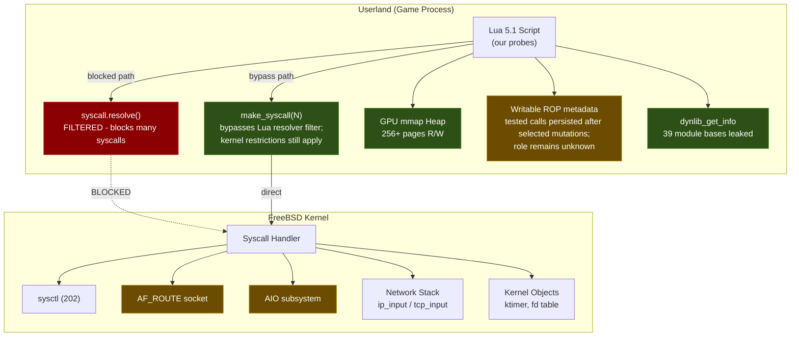
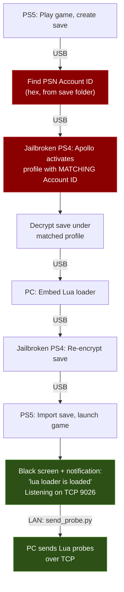

# PS5 Firmware 14.10 - Kernel Research

Open community kernel exploit research on PlayStation 5 firmware **14.10**, conducted via a userland Lua 5.1 loader on TCP 9026.

> **Goal:** Establish a reproducible 14.10 kernel primitive, then assess whether it can support kernel R/W and hypervisor research. None of those kernel-side stages is currently demonstrated.

**Contributors welcome.** Whether you have the hardware or just want to analyze FreeBSD kernel code - there’s work to do. See [CONTRIBUTING.md](CONTRIBUTING.md) to get involved.

## Support This Research

> **Hardware status:** The range-based captures documented in the companion repository are labeled 13.60; their acquisition authenticity remains unresolved. Those files are not complete kernel sections, and no verified 14.10 kernel image is available here.

**Recorded funding target: $450 CAD.**

**Recorded funding progress: $369.26 / $450 CAD raised.** Funding totals are separate from the evidence-weighted research progress below.

[](https://www.paypal.me/SalwanStudios)

Every dollar helps, but no pressure — this research stays open and free regardless.

<!-- RESEARCH_PROGRESS:START -->
## Research progress

[](docs/PROGRESS_AUDIT.md)

**25/100 (~25%) on a subjective, evidence-weighted milestone rubric.** This is not a measured percentage of unknown exploit work, time remaining, or probability of success. **Kernel read/write on 14.10 is not demonstrated.** Hypervisor bypass is excluded from this score.

| Milestone | Points earned / weight |
|---|---:|
| 14.10 research environment | 10/10 |
| Probe tooling and captured evidence | 10/10 |
| Target characterization | 5/15 |
| Validated 14.10 kernel vulnerability | 0/20 |
| Demonstrated 14.10 kernel read/write | 0/25 |
| Repeatable complete kernel exploit | 0/20 |

Audited 2026-10-18. [Evidence and counting rules](docs/PROGRESS_AUDIT.md) · [Machine-readable rubric](docs/progress.json) · [Website](https://marwanmohamed.ca/researchps5#research-progress)

**Correction:** Probe 45c retracts earlier `fn_addr`/ROP execution and W^X-bypass claims. Those are not credited by this meter; historical diagrams and older findings are not current proof. 13.60 artifacts do not establish 14.10 exploitability.
<!-- RESEARCH_PROGRESS:END -->

## Exploit Chain Overview

```mermaid
graph LR
    A["Hamidashi Creative<br/>(Artemis Engine)"] -->|modified save file| B["Lua 5.1 Loader<br/>TCP 9026"]
    B -->|memory.* / syscall.*| C["Confirmed userland behavior<br/>Heap R/W, module info,<br/>syscall wrapper"]
    C -->|tested syscall numbers| D["Individual syscall observations<br/>results vary by call and arguments"]
    D -->|"No kernel primitive established"| E["KASLR / kernel R/W<br/>not demonstrated"]
    E -->|requires separate evidence| F["Hypervisor research<br/>not demonstrated on 14.10"]

    style A fill:#2d5016,stroke:#4a8c2a,color:#fff
    style B fill:#2d5016,stroke:#4a8c2a,color:#fff
    style C fill:#2d5016,stroke:#4a8c2a,color:#fff
    style D fill:#6b4c00,stroke:#b8860b,color:#fff
    style E fill:#8b0000,stroke:#cd5c5c,color:#fff
    style F fill:#8b0000,stroke:#cd5c5c,color:#fff
```



> Green = confirmed working. Yellow = partially open. Red = not yet achieved.

## Status

Confirmed userland capabilities include Lua execution, heap access, module-base discovery, and tested syscall invocation through make_syscall(). Probe 45c recorded ordinary syscall results after specific fn_addr and chain mutations. This contradicts the earlier execution interpretation for those tested calls, but does not identify the complete dispatch implementation. Probes 43a–43p have already been sent. The 2026-10-17 evidence audit found several follow-up claims inconclusive; probes 53a–53d are prepared for controlled retests.

**Current milestone:** Establish a reproducible kernel primitive on 14.10. The prepared 53a–53d tests revisit specific incomplete observations; passing one test would still require independent validation before claiming a disclosure or exploit.

Research progress is tracked on the evidence-weighted milestone rubric below. The current 25/100 estimate is not a measured percentage of exploit completion: userland behavior has been extensively probed; four evidence-audit retests are prepared but not run; kernel disclosure, KASLR defeat, kernel read/write, native code execution, and hypervisor bypass remain unestablished. A verified 14.10 kernel-code artifact is also unavailable, so a direct handler diff is not currently supported.

See [CHANGELOG.md](CHANGELOG.md) for a detailed timeline.

## Related V13.60 Research

The companion [PS5 V13.60 Research](https://github.com/ZigZagBoi1/PS5-V13.60-Research) repository maintains the firmware 13.60 Relapse and Byepervisor-Reborn research, its local browser site, and observed stage evidence. This V14.10 project retains `docs/ps5_13.60_sysent.json` for existing strategy and probe tooling; the source copy and attribution are maintained in the companion repository. Relapse's 13.60 support does not imply support on 14.10.

## Architecture



## Confirmed Userland Capabilities

| Primitive | How | Probe |
|-----------|-----|-------|
| Raw syscall invocation | `make_syscall(N)` bypasses the Lua `syscall.resolve()` filter for tested numbers; kernel-side restrictions still apply | 41w |
| Heap R/W (256+ pages) | GPU mmap adjacency, no guard pages | 41c |
| Userland module-base discovery | `dynlib_get_info(593)` returned base information for 39 userland modules in probe 41o; this does not defeat kernel ASLR | 41o |
| eboot gadget catalog | Gadget bytes were read from the RX eboot segment; no working execution path was established | 41r–t |
| Writable ROP metadata | fn_addr, chain, and argument slots are writable; tested calls continued after specific mutations, so an execution role is not established | 41z, 45c |
| Full process VM map | sys 674 returns 317 named regions with protections; all userland VA, no kernel pointers | 55e, 55f |
| Module member addresses | sys 649 returns userland addresses for member types 1-4, 7, 8 across 39 modules | 54k |
| Network packet injection | RAW socket + IP_HDRINCL, TCP connect-back with ARP responder | 34–39 |
| Kernel info via sysctl | FreeBSD r230171, securelevel=1024, 16KB pages | 42a |

These results establish userland memory control and syscall invocation. They do **not** establish kernel read/write, native code execution, or an arbitrary function-call primitive.

## Key Constraints

- **W^X enforced** - `mmap(RWX)` gives RW only; `mprotect(EXEC)` always fails
- **Execute-only memory (XOM)** - system lib .text is XO (reading crashes); eboot is RX
- **No threading** - `fork`, `rfork`, and `thr_new` were blocked or crashed in tested paths, including raw-syscall checks
- **AIO — confirmed hard wall** - sys 661 instantly kills the process on 14.10 (probes 54c, 54f)
- **Per-connection ASLR** - fresh process per TCP connection
- **No kernel pointers found** - extensive scanning across sysctl, AF_ROUTE, sys 674 VM map (317 regions), sys 649 module members, kinfo_proc, net.route.iflistl — all userland or sentinels
- **AF_ROUTE KASLR (Relapse technique) — confirmed dead** - kernel sanitizes route messages on 14.10 (probe 53b)
- **RDMSR blocked** - sys 626 and sys 567 return -1 for all MSR indices (probe 54k)
- **/dev/dmem0** - GPU aperture only, cannot access CPU/kernel physical memory

## Current Research Status

Phase 14 (probes 54a–55g) conducted deep testing of Sony syscalls, KASLR candidates, and CClosure redirect paths. Key outcomes: AIO is confirmed lethal (54c/54f). AF_ROUTE is confirmed sanitized on 14.10 (53b). RDMSR blocked (54k). sys 674 returns a complete 317-region VM map but with zero kernel pointers (55e/55f). sys 622 device control returns Sony error 0x800E0001 for all 400+ commands (55c). sys 601 process control mostly dead (55d). sys 643 chicken switches have no observable effect (55a).

**Active lead:** Probe 54q's CClosure +0x20 redirect caused a 15-second hang (IDLE_TIMEOUT) — the write itself blocked without crashing. This is the most anomalous signal observed and is under investigation (55g). The CClosure dispatch mechanism remains uncharacterized.

A kernel vulnerability on 14.10 has not been demonstrated in this repository. See [the evidence audit](docs/EVIDENCE_AUDIT_2026-10-17.md) for the remaining gaps.

## Repository Structure

```
probes/
  phase1_identity_layout/    # 01–08: system ID, syscalls, memory layout
  phase2_kernel_objects/     # 09–21: UMTX, nwake, dmem, AIO, kqueue
  phase3_signals_codexec/    # 22–26: signals, sigaltstack, W^X, XOM
  phase4_ipc_network/        # 27–31: threading, fd passing, socket opts
  phase5_buffer_io/          # 32–33: buffer stress, MSG_DONTWAIT
  phase6_raw_packets/        # 34–39: RAW sockets, fragments, IP options
  phase7_heap_exploitation/  # 40–41: GPU mmap, heap R/W, ROP, ASLR bypass
  phase8_live_network/       # 40tcp, 42: TCP fuzz, ktimer, live testing
  phase9_kaslr_defeat/       # 42b–42j: KASLR attempts, ROP architecture
  phase10_untested_theories/ # 43a–43p: theory-driven probes (results recorded)
  phase13_52batch/           # 52a–52b: prepared survey/oracle scripts; no saved results
  phase13_53batch/           # 53a–53d: evidence-audit retests
  phase14_final_push/        # 54a–55g: deep syscall survey, CClosure redirect, KASLR, device control
  42f2–42i (root)            # Physical memory & ROP chain analysis probes
results/                     # Raw output logs (mirrored phase structure)
tools/                       # send_probe.py, send_probe.ps1, run_session40.py
docs/
  ATTACK_SURFACE.md          # Complete syscall status map
  FINDINGS.md                # 78 detailed technical findings
  PROBE_INDEX.md             # Every probe with status and key result
  STRATEGY.md                # Exploit strategy and dead ends
  UNTESTED_THEORIES.md       # 17 theories ranked by priority
```

## Environment

| Property | Value |
|----------|-------|
| Firmware | 14.10 |
| Kernel | FreeBSD r230171 (Sep 28 2026) |
| Entry point | Lua 5.1 loader on TCP 9026 |
| Page size | 16 KB (0x4000) |
| CPU | Zen 2, 8C/16T (16 logical cores) |
| Securelevel | 1024 (PS5-specific) |

## Quick Start

```bash
# Send a probe (Python)
PYTHONIOENCODING=utf-8 python tools/send_probe.py --save probes/phase10_untested_theories/43a_kldstat_kaslr.lua

# Send a probe (PowerShell, no Python required)
.\tools\send_probe.ps1 probes\phase10_untested_theories\43a_kldstat_kaslr.lua -Save

# TCP connect-back fuzz session
python tools/run_session40.py --ps5-ip YOUR_PS5_IP --fake-ip YOUR_TEST_HOST_IP
```

See [tools/README.md](tools/README.md) for details.

## Key Findings

1. **Writable ROP-shaped metadata mapped** - The fn_addr, chain, and argument slots are writable, but probe 45c found tested syscall results persisted after specific mutations; this does not establish an execution primitive.
2. **Resolver-filter bypass for tested calls** - make_syscall(N) bypasses syscall.resolve() for tested numbers; kernel-side restrictions still apply.
3. **Userland module-base discovery** - dynlib_get_info(593) returned base information for 39 userland modules in probe 41o; this does not defeat kernel ASLR.
4. **GPU Heap Primitive** - 256+ adjacent 16KB pages via GPU mmap, no guard pages between allocations
5. **Physical Memory Isolation** - `/dev/dmem0` maps only GPU GDDR6 aperture, not CPU DRAM

See [docs/FINDINGS.md](docs/FINDINGS.md) for all 78 findings.

## Lua 5.1 Constraints

1. **uint64 for addresses >32 bits**: `uint64(string.format("0x%X%08X", hi, lo))`
2. **pcall wrapping**: `pcall(function() return memory.read_qword(addr) end)`
3. **Lua 5.1 only**: no `goto`/labels - use `repeat...until true` + `break`
4. **XO pages bypass pcall**: reading execute-only memory kills the process
5. **Fresh ASLR per connection**: re-derive all addresses each run

## Userland Entry

The exploit chain uses **Hamidashi Creative** (a Japanese visual novel on the Artemis/Lua engine) as the entry point. A modified save file embeds the Lua loader, which starts a TCP listener on port 9026.



> Red = critical step (Account ID must match or PS5 rejects the save)

- **Game:** Hamidashi Creative (はみだしクリエイティブ) - free demo on Japanese PSN
- **Loader:** Based on [shahrilnet/remote_lua_loader](https://github.com/shahrilnet/remote_lua_loader)
- **Kernel offsets:** From [@hammer-83](https://github.com/hammer-83)'s [ps5-jar-loader](https://github.com/hammer-83/ps5-jar-loader) (fw 1.00–10.01 only - 14.10 offsets TBD)
- **Entry method:** Save file exploit via PS4 backwards compatibility

See [docs/USERLAND_ENTRY.md](docs/USERLAND_ENTRY.md) for the full setup guide, save file chain walkthrough, and supported games list.

## Documentation

| Document | Contents |
|----------|----------|
| [CHANGELOG.md](CHANGELOG.md) | Phase-by-phase progress timeline |
| [CONTRIBUTING.md](CONTRIBUTING.md) | How to contribute to this project |
| [docs/USERLAND_ENTRY.md](docs/USERLAND_ENTRY.md) | Userland exploit setup guide and game details |
| [docs/PROBE_INDEX.md](docs/PROBE_INDEX.md) | Full probe-by-probe breakdown |
| [docs/EVIDENCE_AUDIT_2026-10-17.md](docs/EVIDENCE_AUDIT_2026-10-17.md) | Claim-by-claim evidence review, contradictions, failed runs, provenance, and gaps |
| [docs/INDEPENDENT_EVIDENCE_AUDIT_2026-10-17.md](docs/INDEPENDENT_EVIDENCE_AUDIT_2026-10-17.md) | Full ledger adjudication, artifact hashes, log counts, and missing-evidence register |
| [docs/RETEST_PLAN_53.md](docs/RETEST_PLAN_53.md) | Run order, evidence requirements, and interpretation rules for the prepared retests |
| [docs/ATTACK_SURFACE.md](docs/ATTACK_SURFACE.md) | Complete syscall status map |
| [docs/FINDINGS.md](docs/FINDINGS.md) | 78 detailed technical findings |
| [docs/STRATEGY.md](docs/STRATEGY.md) | Exploit strategy and dead ends |
| [docs/UNTESTED_THEORIES.md](docs/UNTESTED_THEORIES.md) | 17 ranked exploit theories and 3 attack chains |
| [docs/RESEARCH_PAPER.md](docs/RESEARCH_PAPER.md) | Full technical research paper covering methodology and findings |

## Use AI to Help

All research data is in this repo specifically so anyone can feed it to their AI model of choice. Here's how to get the most out of it:

**Give your AI this context:**
1. Start with `README.md` and `CLAUDE.md` for the full picture
2. Feed it `docs/STRATEGY.md` for what's been tried and what's next
3. Feed it `docs/FINDINGS.md` for all 25 technical findings
4. Feed it `docs/UNTESTED_THEORIES.md` for the current theory queue
5. Point it at specific probe results in `results/` for raw data analysis

**Ask your AI to:**
- Analyze probe results for kernel pointer patterns we missed
- Cross-reference our findings against FreeBSD kernel source code
- Suggest new attack vectors based on the confirmed primitives
- Review the `make_syscall` bypass for syscalls we haven't tried yet
- Write new probes following the template in `CLAUDE.md`
- Look for timing side-channels or information leaks in the syscall results

**What we need AI help with most:**
- **CClosure redirect analysis** - probe 54q's +0x20 write caused a 15s hang; understanding why could unlock native code execution
- **FreeBSD r230171 kernel source analysis** - Find exploitable code paths reachable from our ~40 working syscalls
- **Sony syscall survey completion** - probes 52a/52b cover syscalls 627-676 and the 624 heap oracle; not yet run
- **KASLR defeat** - all known paths are dead (AF_ROUTE sanitized, RDMSR blocked, no kernel pointers in VM map or module info); novel approaches needed

The more models looking at this data from different angles, the faster we find a kernel primitive.

## Credits

- Userland loader: [@shahrilnet](https://github.com/shahrilnet) via [remote_lua_loader](https://github.com/shahrilnet/remote_lua_loader)
- Kernel offsets (fw 1.00-10.01): [@hammer-83](https://github.com/hammer-83) via [ps5-jar-loader](https://github.com/hammer-83/ps5-jar-loader)
- PS4 jailbreak: [GoldHEN](https://github.com/GoldHEN/GoldHEN) by [@SiSTRo](https://github.com/SiSTRo) and the GoldHEN team
- Save file management: [Apollo Save Tool](https://github.com/bucanero/apollo-ps4) by [@bucanero](https://github.com/bucanero)
- Relapse exploit research (fw 7.00-13.60): AF_ROUTE KASLR defeat technique and AIO race condition methodology
- Artemis engine Lua research: the PS5 homebrew scene

## License

This research is for educational and authorized security research purposes only.
